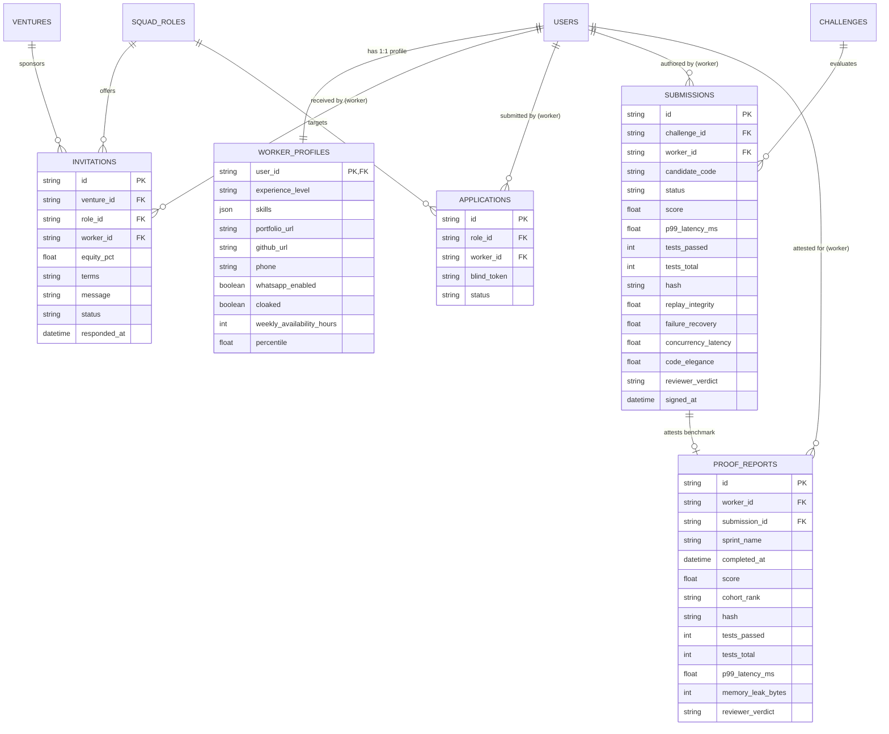

# VentureForge AI — Worker Database Architecture & Data Notes (Person B)

## 1. Scope & Ownership
This document specifies the Worker domain data layer owned by **Person B**, implementing the contracts agreed in `docs/SHARED_CONTRACT.md`.

### Owned Files
- `database/models/worker_profile.py`: Worker profile model with blind cloaking.
- `database/models/worker_activity.py`: Worker activity, invitations, applications, submissions, and proof reports.
- `database/seed/seed_worker_people.py`: Phase 10 seed for worker candidate users.
- `database/seed/seed_worker_profiles.py`: Phase 20 seed for 1:1 worker profiles.
- `database/seed/seed_worker_activity.py`: Phase 40/50 seed for invitations, applications, submissions, and proof reports.
- `database/queries/worker.py`: Read query helpers scoped strictly by `worker_id` (Role Isolation Rule #4).
- `database/tests/test_worker_profiles.py`: Automated tests for 1:1 profile integrity and cloaked defaults.
- `database/tests/test_worker_activity.py`: Automated tests for FK resolution, unique constraints, and canonical hashes.
- `database/tests/test_worker_integrity.py`: Automated tests for candidate code uniqueness, blind protocol zero-PII leak, and response timestamps.
- `docs/DATA_NOTES_WORKER.md`: Technical documentation and ER summary for the worker domain.

---

## 2. Entity-Relationship (ER) Architecture

---

## 3. Table Specifications & Constraints

### 3.1 `worker_profiles`
- **Primary Key**: `user_id` (String(64), FK -> `users.id` ON DELETE CASCADE).
- **1:1 Mapping**: Every worker user in `users` with `role == 'worker'` has exactly one profile record.
- **Cloaked Default**: Defaults to `True`. Shields worker identity until uncloaked or contractually revealed.
- **Skills**: JSON list of string skill badges (e.g. `["Rust", "Distributed Systems", "Fintech Protocols"]`).
- **Percentile**: Benchmark percentile score across cohort (e.g. `96.4`).

### 3.2 `invitations`
- **Primary Key**: `id` (String(64)).
- **Foreign Keys**:
  - `venture_id` -> `ventures.id` (ON DELETE CASCADE, indexed).
  - `role_id` -> `squad_roles.id` (ON DELETE CASCADE, indexed).
  - `worker_id` -> `users.id` (ON DELETE CASCADE, indexed).
- **Unique Constraint**: `UniqueConstraint("role_id", "worker_id", name="uq_invitation_role_worker")` prevents duplicate invitations for the same role and worker.
- **Equity Percentage**: Numeric float (e.g. `15.0`, `12.0`, `14.0`), never a string.
- **Status Lifecycle**: `pending` -> `accepted` | `declined`.
- **Response Timestamp**: `responded_at` is populated immediately upon acceptance or decline.

### 3.3 `applications`
- **Primary Key**: `id` (String(64)).
- **Foreign Keys**:
  - `role_id` -> `squad_roles.id` (ON DELETE CASCADE, indexed).
  - `worker_id` -> `users.id` (ON DELETE CASCADE, indexed).
- **Unique Constraint**: `UniqueConstraint("role_id", "worker_id", name="uq_application_role_worker")` prevents spam applications.
- **Blind Token**: Anonymized evaluation token (e.g. `BLIND-TOK-8821B`). Real name, email, and phone are never present.

### 3.4 `submissions`
- **Primary Key**: `id` (String(64)).
- **Foreign Keys**:
  - `challenge_id` -> `challenges.id` (ON DELETE CASCADE, indexed).
  - `worker_id` -> `users.id` (ON DELETE CASCADE, indexed).
- **Candidate Code**: Anonymized alias (e.g. `Candidate #TX-9042A`, `Candidate #TX-5512B`).
- **Vector Scores**:
  - `replay_integrity` (35% weight)
  - `failure_recovery` (30% weight)
  - `concurrency_latency` (20% weight)
  - `code_elegance` (15% weight)
- **Hash**: 66-character lowercase SHA-256 digest (`0x` + hex) calculated over canonical payload.

### 3.5 `proof_reports`
- **Primary Key**: `id` (String(64)).
- **Foreign Keys**:
  - `worker_id` -> `users.id` (ON DELETE CASCADE, indexed).
  - `submission_id` -> `submissions.id` (ON DELETE SET NULL, nullable, indexed).
- **Hash**: 66-character lowercase SHA-256 digest (`0x` + hex) calculated over canonical report payload.

---

## 4. What the Seed Creates

### Phase 10: Candidates (`seed_worker_people.py`)
- `usr_worker_03`: Elena Vance (`TX-5512B`), High-Throughput Systems Engineer, `elena.vance@startup.io`.
- `usr_worker_04`: Julian Vance (`TX-9042A`), Lead Distributed Systems Architect, `julian.vance@talenthub.io`.
- `usr_worker_05`: Elena Rostova (`TX-8821B`), Infrastructure Security & Sandbox Lead, `elena.rostova@devmesh.net`.
- `usr_worker_extra_1`: Alex Chen (`TX-4401C`), Wasm Sandbox Infrastructure Lead, `alex.chen@wasmstack.io`.
- `usr_worker_extra_2`: Rachel Zhang (`TX-3108D`), Storage Engine Lead Architect, `rachel.zhang@zerocopy.dev`.
- `usr_worker_extra_3`: David Kim (`TX-7720E`), Zero-Copy Network Systems Engineer, `david.kim@lowlatency.net`.

### Phase 20: Profiles (`seed_worker_profiles.py`)
- 6 complete profiles corresponding 1:1 to candidate users, populated with skills, availability (20–30 hrs/wk), percentile standing (90.4%–98.2%), and `cloaked=True`.

### Phase 40: Activity Relations (`seed_worker_activity.py`)
- **Invitations** (3 pending offers to Elena Vance `usr_worker_03`):
  - `inv_1`: Synthetix AI (`ven_synthetix`), `rol_synth_04` (Lead Distributed Systems Architect), 15.0% equity.
  - `inv_2`: PolyMatrix AI (`ven_polymatrix`), `rol_poly_01` (High-Throughput Core Engineer), 12.0% equity.
  - `inv_3`: ChronoDB (`ven_chronodb`), `rol_chrono_01` (Storage Engine Lead Architect), 14.0% equity.
- **Applications** (2 blind submissions):
  - `app_1`: Elena Rostova (`usr_worker_05`) applying to `rol_aether_01` (`BLIND-TOK-8821B`).
  - `app_2`: Alex Chen (`usr_worker_extra_1`) applying to `rol_poly_01` (`BLIND-TOK-4401C`).
- **Submissions** (3 blind evaluations for `chl_synth_01` Sprint #3):
  - `sub_01`: Julian Vance (`Candidate #TX-9042A`), score 94.2, 3.8ms p99, 50k/50k tests passed.
  - `sub_02`: Elena Vance (`Candidate #TX-5512B`), score 88.5, 4.6ms p99, 49.8k/50k tests passed.
  - `sub_03`: Elena Rostova (`Candidate #TX-8821B`), score 84.0, 5.1ms p99, in review.

### Phase 50: Cryptographic Proof Reports (`seed_worker_activity.py`)
- `pr_1`: Elena Vance (`usr_worker_03`), Sprint #3 MicroVM Concurrency, Rank #2 in Cohort, score 96.4, linked to `sub_02`.
- `pr_2`: Elena Vance (`usr_worker_03`), Sprint #2 Distributed Consensus, Rank #4 in Cohort, score 94.0.
- `pr_3`: Elena Vance (`usr_worker_03`), Sprint #1 Zero-Copy Serialization, Rank #3 in Cohort, score 95.8.

---

## 5. Query Read Helpers (`database/queries/worker.py`)

All read helpers strictly isolate data by `worker_id` per **Contract Rule #4**:
- `get_worker_dashboard_data(db, worker_id)`: Single aggregated read providing user details, profile telemetry, pending invitations count, active sprint counts, and proof records.
- `list_worker_invitations(db, worker_id, status=None)`: Scoped list of invitations with optional status filter (`pending`, `accepted`, `declined`).
- `list_open_opportunities(db, worker_id)`: Vacant squad openings with annotated `has_applied` state for the calling worker.
- `get_proof_of_work(db, worker_id, report_id=None)`: Scoped retrieval of proof-of-work attestations preventing cross-worker telemetry leaks.

---

## 6. Automated Integrity & Test Coverage

| Test File | Focus | Tests |
|---|---|---|
| `test_worker_profiles.py` | 1:1 user-profile mapping, `cloaked=True` default, skills JSON formatting, percentile ranges | 5 passed |
| `test_worker_activity.py` | Foreign key resolution, duplicate rejection on unique constraints, byte-for-byte SHA-256 canonical hash verification | 3 passed |
| `test_worker_integrity.py` | Unique candidate codes per worker, zero PII leaks into blind protocols (matches/submissions/applications), accepted/declined timestamp tracking, query isolation | 4 passed |
| `test_founder_models.py` | Founder side models, seed validation, queries, and cap table invariants | 10 passed |
